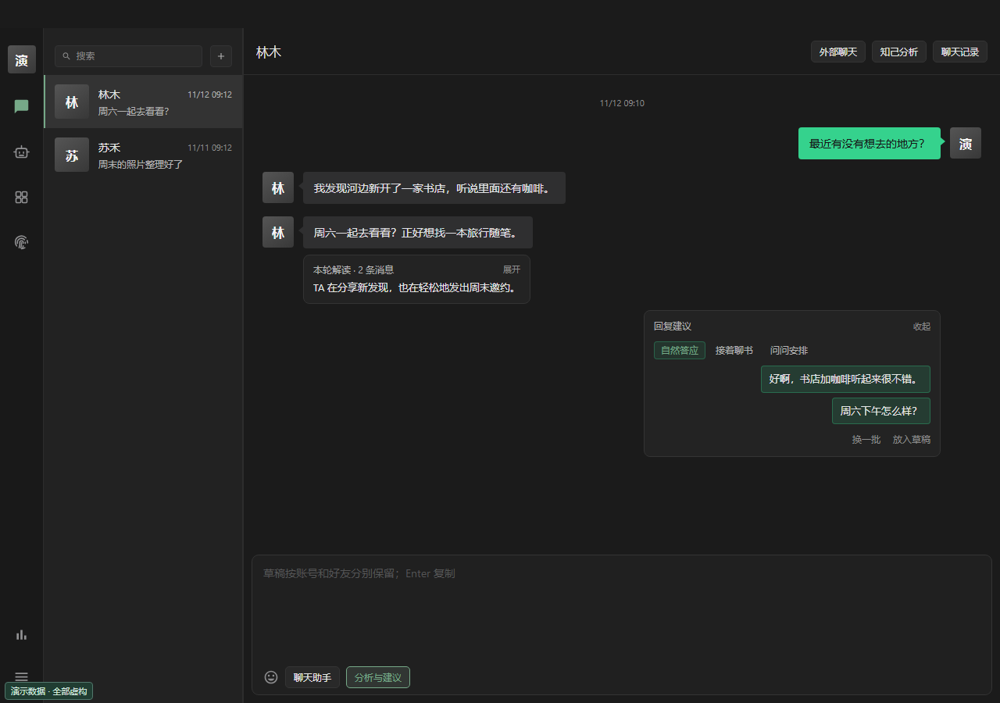
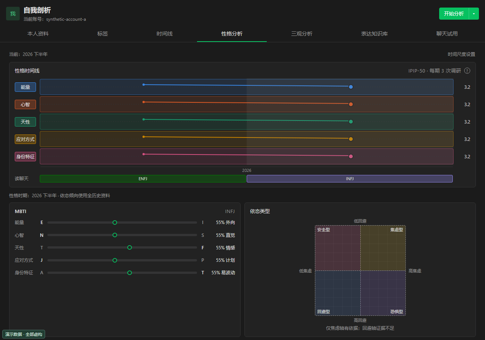
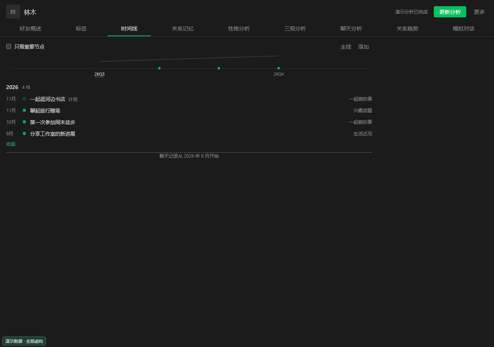
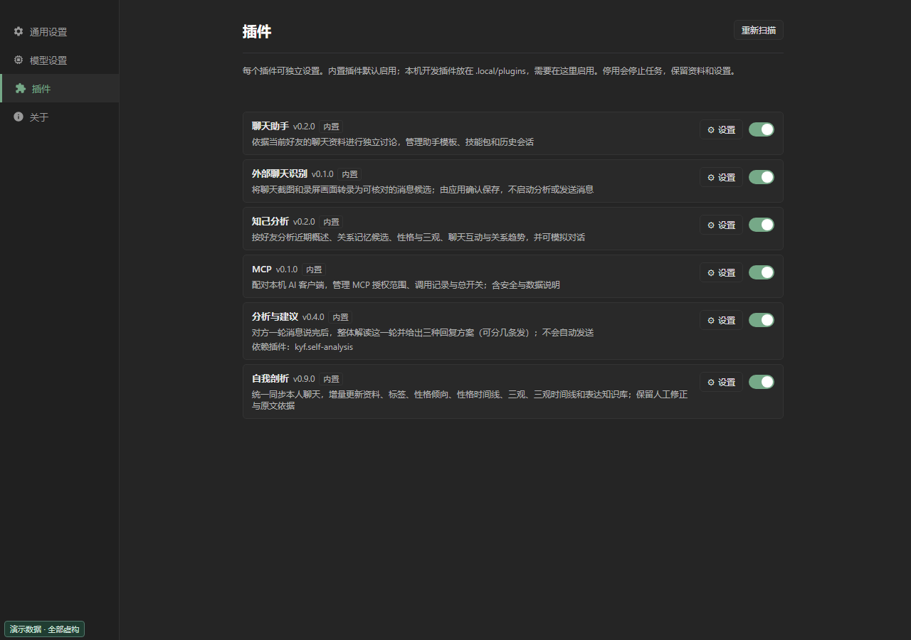

# 知己微信助手 · Zhiji WeChat Assistant

**聊过那么多，你真的了解 TA 吗？**

回看聊天，记住细节，也看看自己。

知己微信助手是一款本地优先的 Windows 微信桌面助手。读懂聊天、分析自己、了解他人，并通过插件按需扩展功能。

本次发布的是**免费开源版**，一台 Windows 电脑即可运行；模型服务与所需 API Key 由用户自行提供。

[官网](https://zhiji.eugenepage.com/) · [功能展示](#功能展示) · [互动演示](https://zhiji.eugenepage.com/#showcase) · [下载与安装](#下载与安装) · [第一次使用](#第一次使用) · [源码运行](#源码运行) · [问题反馈](https://github.com/youdrew/zhiji-wechat-assistant/issues)

## 功能展示

[官网互动演示](https://zhiji.eugenepage.com/#showcase)
从四个方面认识知己：**读懂聊天、分析自己、了解他人、扩展功能**。
截图里的联系人、对话与分析均为虚构示例，真实效果以[正式发布页](https://github.com/youdrew/zhiji-wechat-assistant/releases/latest)为准。
插件式设计，你可以基于公有技术底座，自己定义自己的功能。

<table>
  <tr>
    <td width="50%" align="center"><strong>读懂聊天</strong><br><a href="assets/showcase/chat-2.2.png"></a></td>
    <td width="50%" align="center"><strong>分析自己</strong><br><a href="assets/showcase/self-2.2.png"></a></td>
  </tr>
  <tr>
    <td width="50%" align="center"><strong>了解他人</strong><br><a href="assets/showcase/timeline-2.2.png"></a></td>
    <td width="50%" align="center"><strong>扩展功能</strong><br><a href="assets/showcase/extensions-2.2.png"></a></td>
  </tr>
</table>

### 读懂聊天

**读懂消息里的意思，和聊天助手一起准备回应。**

- 回看单聊与群聊，按关键词和日期查找，浏览图片、语音与视频；双击会话可在独立窗口打开。
- 可为每位好友分别开启“分析”和“建议”。对方连续发来的消息按一轮解读，每轮可生成三种回复方案。
- 在聊天输入框下方打开工具，选择方案后复制或放入草稿，再改成自己的表达。

### 分析自己

**从聊过的话看见自己的变化，也试着和“自己”聊聊。**

- 整理自己的资料与标签，回看经历时间线、性格与三观分析，并核对聊天依据。
- 建立可检索的表达知识库，在“聊天试用”中观察模拟回答，逐步校正对自己的描述。
- 分析与模拟都可以作为反思的起点，由你结合实际经历判断。

[体验自我剖析互动演示 →](https://zhiji.eugenepage.com/demo/self/index.html)

### 了解他人

**记住 TA 的近况、偏好，和你们共同的经历。**

- 查看好友概述、标签、聊天分析与关系趋势；偏好、边界和共同经历由你确认，可以编辑、删除并回查原文。
- 在时间线中查看已发生的事与未来计划，按主题整理、展开事件并核对聊天依据。
- 在好友“聊天试用”中尝试不同表达、准备话题；模拟回答不代表好友本人或其真实想法。

### 扩展功能

**六个内置插件，按需开启、各自设置。**

- 在插件页管理聊天助手、分析与建议、自我剖析、知己分析等能力，按自己的需要启用和配置。
- 导入其他软件的单聊截图或录屏，经识别、核对后保存在本机。
- 统一管理模型连接、用量与调用记录；也可通过可撤销授权的 MCP 接口连接本机 AI 客户端，读取资料、运行分析和管理本地内容。

[体验插件与模型设置互动演示 →](https://zhiji.eugenepage.com/demo/extensions/index.html) · [连接本机 AI 客户端](#连接本机-ai-客户端)

AI 分析可能有误，请结合实际语境核对。回复建议可复制后自行使用；本版不操作微信发送，公开安装包不包含私有微信发送插件、双机发送执行器及其私有依赖。

## 下载与安装

适用于 **Windows 10/11 x64、Windows 微信 4.x**。

Windows 安装包和校验文件见[最新正式版本](https://github.com/youdrew/zhiji-wechat-assistant/releases/latest)。也可以按下方步骤从源码运行。

下载安装：

1. 从[最新正式版本](https://github.com/youdrew/zhiji-wechat-assistant/releases/latest)下载 Windows x64 安装包。
2. 双击安装，完成后从桌面或开始菜单打开“知己微信助手”。
3. 按下面的步骤连接模型服务，开始使用。

安装包自带运行环境，无需另装 Node.js、Python 或 .NET。首版不使用应用内自动更新，后续版本到官方发布页下载。也可按下方步骤从源码运行。

使用 AI 功能需要自行配置兼容的模型服务。

**聊天助手讨论需要在本机另装 DeepSeek Harness 桌面版。** 安装后回到知己，打开已有讨论即可继续，也可以新建讨论。消息分析与回复建议只需配置模型服务。[DeepSeek Harness 官方项目](https://github.com/deepseek-ai/deepseek-harness)

## 第一次使用

1. 登录 Windows 微信，再打开知己微信助手。
2. 在“设置 → 模型设置”中填写模型服务地址、模型名称和所需凭据，测试连接后保存。也可连接你在本机或局域网运行的模型服务。
3. 在会话管理中添加想查看的好友或群聊。
4. 打开好友聊天，使用“知己分析”整理记忆，或向聊天助手提问。需要持续建议时，在聊天输入框下方按需开启消息分析或回复建议。

聊天助手需要模型支持工具调用；图片及录屏识别需要支持图片输入的模型。API 协议兼容不代表所有模型服务都已验证。

## 连接本机 AI 客户端

在同一台 Windows 电脑的 Claude Code、Codex、Cursor 或 WorkBuddy 中发送这一句话。Agent 需要联网、运行命令及编辑配置的权限。

> 请阅读 https://zhiji.eugenepage.com/install.html，帮我安装知己微信助手并接入当前客户端。

安装脚本可下载知己、检查安装包哈希并发起账号配对。你在安装界面和知己授权窗口确认后，Agent 继续检查连接。详细步骤及当前验收范围见[安装说明](https://zhiji.eugenepage.com/install.html)。

从[官方 v2.2.0 发布附件](https://github.com/youdrew/zhiji-wechat-assistant/releases/tag/v2.2.0)下载 `install-zhiji.ps1`，也可以自行运行。例如 Codex 使用

```powershell
powershell -NoProfile -ExecutionPolicy Bypass -File .\install-zhiji.ps1 -Client codex
```

| 客户端 | 参数 | 配置方式 |
| --- | --- | --- |
| Claude Code | `-Client claude-code` | 脚本自动合并 |
| Codex | `-Client codex` | 脚本自动合并 |
| Cursor | `-Client cursor` | 脚本自动合并 |
| DeepSeek Harness | `-Client deepseek-harness` | 脚本自动合并 |
| WorkBuddy | `-Client generic --name workbuddy` | 由 Agent 将输出片段合并到 `~/.workbuddy/mcp.json` |
| 其他本机 stdio MCP 客户端 | `-Client generic --name <独立连接名>` | 按其官方配置格式导入 |

WorkBuddy 按官方 MCP 文档提供接入步骤，尚未完成真实客户端验收。需要重新加载 MCP 或新开会话的客户端，加载后还应实际调用 `zhiji_ping` 验证。

已安装知己时，也可直接调用自带工具。将 `<安装目录>` 替换为实际安装路径。

```powershell
$client = "<安装目录>\resources\client"
& "$client\runtime\python\python.exe" "$client\scripts\zhiji-mcp-cli.py" connect --client claude-code
```

在知己弹出的窗口选择允许读取的账号，确认后重新打开客户端。默认只读。基础读取无需在知己配置模型，专项分析仍使用知己的模型设置。客户端可选择 `claude-code`、`codex`、`cursor`、`deepseek-harness` 或 `generic`。通用模式会输出配置片段，需要粘贴到客户端。

Claude Code 可加 `--install-hook`，在下一次提问时接收新消息提醒。图片通过 `zhiji_get_media` 返回，显示和识别取决于客户端及所用模型。Agent 可打开授权联系人的只读聊天记录窗口。你也可以在知己设置里撤销客户端授权。

## 源码运行

需要 Node.js 24.11.1、Python 3.14 和 npm。在 PowerShell 中执行：

```powershell
git clone https://github.com/youdrew/zhiji-wechat-assistant.git
cd zhiji-wechat-assistant
py -3.14 -m venv .venv
$env:KYF_PYTHON = (Resolve-Path .\.venv\Scripts\python.exe).Path
npm.cmd ci
& $env:KYF_PYTHON -m pip install --no-deps -r python-requirements.lock.txt
& $env:KYF_PYTHON -m pip install --no-deps PyYAML==6.0.3
npm.cmd run build:advisor-ui
npm.cmd start
```

源码运行同样需要自己的模型服务。运行资料与开发文档留在本机；公开代码和安装包不包含项目 `docs/` 或生成的 benchmark 结果。打包还需按固定清单准备媒体与原生运行库，来源和许可见[第三方声明](THIRD_PARTY_NOTICES.md)。

## 数据会去哪里

- 聊天记录、关系记忆和个人设置保存在本机。
- 使用 API 模型时，所需聊天内容、摘要或图片会发往**你配置的模型服务**；本地优先不等于始终离线。
- 聊天助手默认不联网；主动启用搜索后，搜索关键词会发送到你配置的搜索源。

只处理你有权访问的记录。反馈问题前，请先去除聊天正文、账号标识和密钥。

## 联系与来源

- 作者博客：[EugenePage](https://eugenepage.com)
- 问题反馈：[GitHub Issues](https://github.com/youdrew/zhiji-wechat-assistant/issues)

本项目基于 [tswawa/WechatVibe](https://github.com/tswawa/WechatVibe) 独立开发，感谢原作者、贡献者及各上游项目。代码采用 [Apache-2.0](LICENSE)，第三方组件、模型和素材遵循各自许可；完整署名与许可入口见[第三方声明](THIRD_PARTY_NOTICES.md)。本项目独立维护，不代表腾讯、微信或上游项目，也没有其官方背书。

有新功能建议？欢迎发邮件至 [youdrewxuan@icloud.com](mailto:youdrewxuan@icloud.com)。
