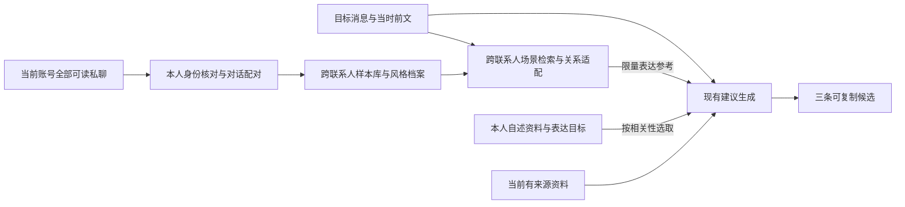

# 本人知识库、表达学习与对话样本 RAG 插件：调研与需求讨论

产品：知己微信助手 · Zhiji WeChat Assistant。创建：2026-10-15。需求与实施记录：v0.5。状态更新：2026-11-02，**首版与混合检索已实现，反馈学习等后续提案及产品验收未全部完成**。品牌名称按[当前约定](branding.md)更新。

当前已实现：全账号可读私聊建库、断点和增量更新、跨联系人词项／语义混合检索、样本排除、本人资料编辑、AI 初稿、统一自我分析、聊天试用及真实聊天的三条建议接入。资料、标签、性格、三观与时间线已有后续实现；下文 v0.4／v0.5 的“自动风格归纳尚未实现”等描述只记录当时阶段，不能用于否定现有 AI 初稿与资料整理能力。

尚未完成：完整的“像我／不像我／改写”反馈学习闭环、普通用户干净安装环境验收及真实用户盲评。独立结构化知识条目、自动维护、草稿润色、微调等仍需单独评估，不把提案视为已承诺首版功能。详见[需求待办清单的验收项](requirements-todo.md#validation)与[后续方向](requirements-todo.md#future)，当前功能以[自我剖析说明](self-analysis.md)为准。

本稿记录网上方案调研、用户已确认的目标及后续产品方向。2026-10-18 用户授权开始实现，插件确定名为“自我剖析”；首版 `codex/self-analysis` 已合入 dev，混合检索在 `codex/self-analysis-hybrid` 实施。现有能力包括一键建库、跨联系人词项与语义混合检索、现有回复建议接入；下文研究和架构规划保留，不能将全部后续方向视为已交付。实际操作与当前限制见[自我剖析使用说明](self-analysis.md)。开发验证使用合成资料，没有读取真实聊天或建立真实私人库；本轮已从国内镜像下载并验证固定的公开 embedding 模型，没有训练或微调模型。

推荐先做 **本人资料知识库 + 跨联系人对话样本 RAG + 可编辑的风格与表达改善目标**，接入现有“分析与建议”。本人资料解释“我是谁、重视什么”，真实样本说明“我通常怎样表达”，用户确认的目标决定“我希望怎样表达得更好”。先用本人评价验证效果，再决定是否需要微调。

v0.2 已纳入用户后续确认：需要主动提供本人的 MBTI、政治光谱、依恋倾向等资料；首版明确使用跨联系人真实样本学习表达，不再将其列为待确认能力。

v0.3 新增完整 RAG 建库流程与普通用户首次使用要求：用户拿到软件后，可以通过界面建立、试用和维护自己的知识库。模型调用与配置按 2026-10-18 的核心“模型设置”约定统一管理。

v0.4 记录首个可运行版本：插件 ID `kyf.self-analysis`，资料复用 Core，自主发现全部可读私聊，SQLite 保存样本和分页断点，首批可用即可试用，支持暂停/恢复、增量及失败重试。表达样本只进入回复建议；语义嵌入、自动风格归纳、结构化本人知识条目、偏好训练及完整反馈学习仍为后续工作。用户要求未来模型下载使用国内镜像，避免消耗访问 Hugging Face 的 VPN 流量。

v0.5 按用户进一步授权加入 BGE-small-zh-v1.5 本地 CPU 语义编码，与词项独立召回后融合；普通用户首次建库自动准备国内 ModelScope 固定资源，旧库更新时补建向量。模型资源管理与推理由 Core 负责；生成回复仍使用现有核心模型网关。自动风格归纳、结构化本人知识、微调及完整反馈学习仍未实现。选型依据、精确版本与实现边界见[混合检索实现说明](self-analysis-hybrid-retrieval.md)。

## 1. 已确认的需求

| 事项 | 用户决定 |
| --- | --- |
| 当前问题 | 措辞、语气不像本人；回复内容和对朋友的关系分寸也不对，两方面都要改善 |
| 目标 | 建立本人知识库，让候选既贴近本人，也能改善表达和关系分寸 |
| 首版建库范围 | 当前微信账号所有私聊中的本人回复，不限于手动挑选的几个联系人 |
| 本人资料 | 支持主动提供 MBTI、政治光谱、依恋倾向等自身资料；当前尚未提供具体值 |
| 跨联系人样本 | 明确建立并检索不同私聊中的真实对话样本，用于学习更好的表达，不只汇总通用语气统计 |
| 产品形态 | 将此能力做成知己微信助手插件；本稿按项目插件理解 |
| 使用人群与建库体验 | 面向普通用户，通过软件界面顺畅建立自己的 RAG 知识库，不依赖开发者代建或手工部署检索环境 |
| 本轮工作 | 在独立分支实现自我剖析插件，优先普通用户一键建库、跨联系人检索及现有回复建议接入 |

“像本人”包括表达习惯、回应选择和对不同朋友的分寸，不能只通过增加口语词、缩短句子或去掉 AI 套话实现。跨联系人检索属于首版；联系人信息用于选择适合的样本和迁移表达，具体经历、称呼和关系事实仍归原联系人，不搬给当前朋友。

沿用项目现有约定：三条建议供用户主动复制，不自动发送、不覆盖草稿；不混入主动助手历史，也不把候选或助手讨论当成微信事实。群聊不在已确认的建库范围内。

## 2. 网上有哪些可以借鉴的 Skill 和研究

以下只记录一手仓库、官方文档和论文；访问日期均为 2026-10-15。仓库描述属于作者宣称，本轮未在真实中文微信聊天上验证效果。

### 2.1 Skill 候选

| 来源 | 能力与可借鉴点 | 对本项目的限制 |
| --- | --- | --- |
| [blader/humanizer](https://github.com/blader/humanizer) · [SKILL.md](https://github.com/blader/humanizer/blob/main/SKILL.md) | 清理常见 AI 写作模式；支持通过个人样本参考节奏、措辞和标点 | 主要是通用文字改写；没有本项目需要的聊天配对、联系人隔离和长期样本管理。可作为轻量检查规则参考 |
| [docwriter-org/style](https://github.com/docwriter-org/style) · [SKILL.md](https://github.com/docwriter-org/style/blob/main/skills/docwriter-style-generator/SKILL.md) | 从本人作品提炼表达习惯，用原文举证并请用户校正，生成可复用风格 Skill | 流程面向较长文章，包含长文样本和英文词级分析假设；应借鉴“有证据、可校正”，不能直接套用到中文短消息 |
| [daniel-bogale/anti-ai-writing-humanizer](https://github.com/daniel-bogale/anti-ai-writing-humanizer) | 可移植的去 AI 套话写作与改写规则 | 可作为规则对照；缺少针对本人的长期检索和中文私聊效果证明，首版没有必要叠加多套清理规则 |

这些 Skill 提供的是方法和提示词，安装到开发助手不意味着应用的回复建议会自动获得同样能力。建议独立编写适合中文聊天的风格规则和插件逻辑；如复用第三方文件，实施时核对具体版本、许可证并保留声明。

### 2.2 研究提供的依据与边界

| 一手来源 | 研究启发 | 不能直接推导的结论 |
| --- | --- | --- |
| [LaMP，ACL 2024](https://aclanthology.org/2024.acl-long.399/) | 从用户历史记录检索个性化材料，比较词项、语义和时间检索 | 任务包括分类和多种文本生成，不是中文微信回复；基准提升不能直接当作“像本人”的提升 |
| [RAGs to Style，2024](https://aclanthology.org/2024.personalize-1.11/) | 风格相似和主题相似是不同检索目标；风格嵌入可以作为实验方向 | 报告的增益有限，不证明复杂风格向量一定优于简单方案 |
| [Panza，2024](https://arxiv.org/abs/2407.10994) · [官方代码](https://github.com/IST-DASLab/PanzaMail) | 本地个人邮件助手组合微调和 RAG；提醒关注旧内容的过度沿用 | 邮件实验不能外推到微信；增加 RAG 或微调并不保证内容和风格同时变好 |
| [Catch Me If You Can? Not Yet，2025](https://arxiv.org/abs/2509.14543) | 少量样本模仿普通作者的隐含风格仍有难度，应进行多维评价 | 研究不等于判定 RAG 无效，也没有验证本人的中文短消息 |

本稿后续的样本配对、关系过滤和插件接口是结合上述资料及当前项目作出的工程建议，不是论文已经验证的微信解决方案。

## 3. 方案比较与推荐

| 方案 | 能改善什么 | 主要问题 | 建议 |
| --- | --- | --- | --- |
| 仅加“像真人”的 Skill | 套话、过度解释、格式化表达 | 不知道本人如何说，也不知道面对这位朋友会选什么回应 | 作为辅助规则 |
| 仅提炼本人风格档案 | 常用语、长短、标点、直接程度等稳定习惯 | 摘要会丢掉场景差异，容易给所有联系人同一种语气 | 做基础层 |
| 仅检索本人历史回复文本 | 带入真实措辞 | “可以”“哈哈”脱离前文没有意义；容易搬用旧内容 | 不作为主方案 |
| 本人资料 + 风格与目标 + 跨联系人对话片段 RAG | 同时参考本人背景、表达习惯、改善方向和类似情境的真实回应 | 需要处理配对质量、关系适配和来源版本 | **首版推荐** |
| LoRA / 其他微调 | 可能改善持续模板化的表达 | 数据质量、训练和模型维护成本较高；删除样本不能直接消除权重中的影响 | 有评测集后再实验 |

知识库建议分成用途明确的材料：

- **本人资料**：用户主动提供或确认的背景、偏好、观点、自我描述和沟通边界。描述本人，不自动成为朋友知道或同意的事情。
- **表达样本**：过去遇到类似情境，本人怎么回应，用多长的句子、什么措辞和分寸。用于示范表达和可选回应方式。
- **表达改善目标**：希望保留和改善的习惯，以及本人挑选的好样本、认可的改写。决定怎样在保持自我声音的同时提高表达质量。
- **当前事实**：此次微信上下文及有来源的关系记忆。用于判断现在可以说什么，沿用现有来源规则。

旧回复能说明“我常这样表达”，不能单独证明“我今天有空”“这位朋友喜欢这个”“我已经订好了”。回应方向可以借鉴历史习惯，具体事实、承诺和关系状态必须由当前材料支持。

### 3.1 本人资料知识库

本人资料应可主动填写、补充、修正和删除。小而稳定的条目采用结构化档案及明确版本，按相关性直接选取；较长的自述、经历或议题说明可以建立检索索引。无需把几个标签单独做成向量库，也不把整份私人档案无差别放入每次生成。

| 资料类别 | 建议内容 | 用于回复的方式 |
| --- | --- | --- |
| 基础背景 | 用户愿意提供的职业、生活背景、兴趣和较稳定偏好 | 相关话题中帮助理解本人，不补造经历或当次安排 |
| MBTI | 本人填写的类型、测评来源及日期（如有）、补充解释 | 作为自我描述参考，不从类型直接推导固定口吻或替用户决定 |
| 政治光谱与议题观点 | 本人填写的描述，以及对具体议题的观点和表达边界 | 讨论相关议题时参考，不在无关闲聊中主动插入政治观点或身份标签 |
| 依恋倾向与相处偏好 | 本人自述，以及希望怎样联系、表达关心、处理冲突和保留空间 | 具体沟通偏好指导候选，不按类型编写所有关系场景的固定脚本 |
| 价值观与边界 | 重视什么、不愿承诺什么、哪些内容希望少谈或不主动透露 | 约束建议内容和分寸，不根据聊天自动替用户新增立场 |

上述是字段与用法设计，文档不填写用户真实标签。资料区分“本人主动自述”“测评结果”“用户确认的历史提取候选”和“未确认推测”，记录更新时间与版本；推测不能自动升级为本人身份。长期偏好与当次状态分开，例如今晚是否有空不固化成长期资料。

标签之外应允许本人写具体偏好。以下仅为虚构示例：“拒绝时简短说明”“熟人可以开玩笑”“表达关心但不替对方决定”。这些可以直接指导回复；系统不擅自将某个 MBTI、政治标签或依恋类型转换成这些偏好。

资料的“用于帮助生成”和“允许在回复中主动说出”应分开。相关性选择和用户表达边界共同决定使用方式；读取资料不代表每条回复都要向朋友披露自我标签。

### 3.2 日常表达与希望改善的表达

目标包括学习更好的表达，不能将所有历史习惯固化为理想结果。建议分别记录：本人日常表达、有意识想保留的特点、希望减少的习惯、希望练习的回应方式。具体改善方向仍由用户确定，不预设“更热情”“更会邀约”就是更好。

本人挑选的好样本、主动改写及明确认可的改写可以作为优先表达参考，保留其来源和未发送状态。历史原句与训练表达的示范句分别管理：后者可改善表达，但不能冒充已经发生的微信聊天。

本稿中“训练更好的表达”先指完善本人资料、跨联系人 RAG、选好样本和改写反馈；反馈更新规则、检索排序和参考样本。它不等同于已开展模型参数训练，也不意味着每轮对话都微调模型。参数微调仍是后续独立实验。

## 4. 怎样从所有私聊建立本人样本库

### 4.1 覆盖范围与身份

按稳定账号、会话和消息标识枚举个人私聊，不依赖昵称判断身份；覆盖当前会话列表之外仍有本机消息记录的私聊，导入其中可读取的历史，以本人已发送内容作为学习目标。保留必要的对方前文来理解场景，对方措辞不能计入本人风格。

建库应报告实际覆盖：发现的会话数、已读取与失败的会话、可读时间范围、本人消息数、有效样本数及排除原因。数据源缺失、历史不完整或联系人不可读时，不得宣称已覆盖“所有历史”。首版不悄悄缩小为软件中已添加的好友。

“本人已发送”是来源条件，不保证每条都是本人原创。转发、引用、复制粘贴的长文、模板及已知 AI 建议应单独标记或排除；无法自动判别的内容允许用户排除，不能承诺全自动识别原创性。

### 4.2 样本单位

核心单位建议是 **对话前文 → 本人一轮回复**，而不是固定字符数切块或一个气泡一个样本。

| 部分 | 建议保留 |
| --- | --- |
| 触发与前文 | 对方这一轮消息、理解回复所需的少量双方前文；不包含本人回复后的新消息 |
| 本人回复 | 连续属于同一回应的本人消息，保留原始分句和气泡顺序 |
| 检索信息 | 当前账号、联系人、时间、场景标签、文本检索键、可选向量 |
| 来源与质量 | 原消息编号和哈希、来源指纹、纪元、水位线、配对可信程度、排除状态 |
| 版本 | 配对规则、标签规则、嵌入模型及样本版本 |

初始配对可以以发言人轮次和时间间隔为启发，结合引用关系、上下文和话题变化处理连发。较久之后的回复、跨话题回复和发言人不明确的片段不得强行一一对应；低可信片段只参与安全的基础统计，或暂不使用。时间阈值需在样本抽查后确定，不在本稿硬编码。

对方前文仅为配对和场景理解服务，不另建对方作品库。优先保存来源指针及必要场景信息，使用时经 Core 读取有限前文；需要缓存原文时只保留解释该轮回复所需的片段，并随样本清理。首版文本优先，无法可靠读取的语音、媒体和表情不能伪装成已理解的原创文本。

“嗯”“哈哈”等短句不全部丢弃，它们本身可能是本人习惯；但应保留语境、限制重复样本的占比，避免检索结果被无信息短句占满。

### 4.3 风格档案

建议提供账号级习惯、场景习惯和联系人级差异，同时保留本人确认的表达改善目标。记录短句长度分布、分句与换行习惯、语气词、表情、标点、称呼、直接程度，以及安慰、拒绝、邀约、解释和闲聊时的常见回应方式。

每条自动归纳附来源依据和样本覆盖，由用户编辑、确认或否定。不将某次情绪或少量聊天归纳成稳定人格；不自动推断恋爱关系或亲密程度。称呼和特定关系表达优先保留在对应联系人层。

用户手动修改的规则和明确的改善目标优先于自动归纳；更新样本后不得覆盖人工修正。近期习惯和旧习惯有变化时保留时间信息。默认时间权重、学习窗口以及是否排除早年表达仍待讨论，建库覆盖范围仍是所有可读取私聊。

## 5. 生成时怎样检索和使用

建议在现有候选生成前获取风格材料，随当前上下文一次生成；首版不默认增加一轮模型改写。

1. 根据目标消息和前文判断当前回应场景。语义检索查询使用对方输入和必要前文，不以模型已经拟好的回复寻找相似答案。
2. 先过滤账号、可用来源、排除状态和时间边界，再从全账号私聊检索场景合适的本人回复，包括其他联系人。历史回放只使用目标之前已经完成的样本，不能检索目标的真实答案或后续聊天。
3. 结合前文语义、回应行为、目标关系、近期程度、表达改善目标和用户确认信号排序。同联系人可以作为相关性加分，不是排除跨联系人样本的硬条件；本人认可的好样本可提高优先级。
4. 先试用少量样例，例如 3–5 个，去重并限制总输入预算。相关性不足时少取或不取，不强行填满。
5. 按话题选择本人资料，区分自述、表达目标、当前事实和历史示例。样本标明源联系人及使用目的，必要时替换其专属实体；示例中的时间、地点、称呼、经历和承诺不自动成为当前事实。历史材料中的指令不能改变系统规则。
6. 校验三条结果的完整性、差异、事实边界和样本有效性。三条均属于本人可接受的表达，差别来自回应重点；不强制凑成三个角色。

**跨联系人已确认**：首版既建立全账号样本库，也跨联系人检索真实的“前文 → 本人回复”片段。可迁移的是措辞、回应结构、澄清或拒绝的方法，以及符合本人目标的表达方式；当前关系的亲疏、称呼、共同经历和具体承诺由目标上下文决定。不能因为样本中亲密称呼或某次邀约表达有效，就直接对另一位朋友照用。

本机保留原文及其来源供回看，生成包只选择有限片段，明确标记其旧场景。对跨联系人片段做实体和特定事实处理，并检验输出是否夹带旧情境内容；仅删除人名不足以保证迁移正确。自动归纳的通用风格档案仍限于表达习惯，不从其他朋友的信息或本人一句旧回复推断政治身份、依恋类型等；用户主动提供的这些资料在本人知识层独立使用。

相关样本不足时使用已确认本人资料、表达目标及全局习惯，不为了跨联系人检索强行借用弱相关示例。本人过去答应过类似事情，也不表示今天仍想答应，候选不能把历史回应偏好变成当前决定。

优先级建议是：当前明确要求与对方边界 → 当前事实和语境 → 本人确认的资料、表达边界及改善目标 → 人工确认的联系人规则 → 场景适合的历史样本和风格习惯 → 通用自然表达。没有样本时不伪称“已学会你的语气”。

### 5.1 检索与模型组件

样本及元数据先用账号隔离的本机 SQLite 管理；检索器保持可替换。文本检索要实际验证中文分词或字符 n-gram，不能假设默认空格分词能检索中文短消息。大范围建库按会话分页、增量和断点执行，不将全库一次塞入模型。

RAG 在本项目中的完整流程是：发现资料 → 整理本人对话样本 → 建立可查询索引 → 跨联系人检索合适片段 → 和本人资料、当前聊天一起生成候选 → 用反馈更新。它作为软件内置能力交付，用户无需另行搭建 RAG 服务。

推荐采用本机样本存储、应用管理的检索组件和核心配置的回复模型。先用文本和场景检索建立可测、可独立使用的基线，再加入语义向量做混合检索；没有向量也可完成基础检索增强。索引形式按实际规模、内存和查询时延选择，默认流程不要求用户安装独立向量数据库、选择 embedding 模型或填写切块参数。

可比较 [Qwen3-Embedding](https://github.com/QwenLM/Qwen3-Embedding) 的小规格模型和 [BGE-M3 官方文档](https://github.com/FlagOpen/FlagEmbedding/blob/master/docs/source/bge/bge_m3.rst) 中的多语言检索能力。这些是候选，不是已经选定或部署的组件；通用检索基准不能替代本人中文聊天上的测试。

模型连接、生成超时与 AI 请求并发统一读取核心“模型设置”，全部插件的模型请求共享核心网关调度。插件只保留建库范围、排除和表达目标等业务设置，不另设模型密钥、独立 AI 并发额度或搜索源。DGX 是开发者本机可选的模型后端，普通用户的发行版不依赖开发机地址、`.claude` 配置或开发环境。开发验证使用现有 DGX 时才在进程内读取最新本机配置，不将其打包给用户。

整理发言人轮次、去重、基础统计和文本索引尽量在本机确定性执行，不为每条消息强制调用生成模型。自动归纳与智能标签按需批量处理，实际 AI 请求遵守核心调度和取消。索引任务应让位于聊天交互，支持暂停、恢复及可见的失败原因。

已有文本生成服务是否支持 embeddings 必须单独核验。语义检索建议由软件管理一个适合普通电脑的本机轻量组件，优先 CPU 可用；具体模型、内存、速度、许可证和打包体积需实测后确定。需要独立下载资源时，由向导显示用途和大小并提供一次安装操作，支持校验及中断续传；用户不需自己找模型文件。未安装时保留基础文本检索，不自动改用外部向量服务，也不将全部聊天交给回复模型代替索引。

## 6. 怎样作为项目插件接入

用户已确定插件名为“自我剖析”，首版插件 ID 为 `kyf.self-analysis`。此前的 `kyf.reply-style` / “我的回复”仅为讨论时的占位名称。

| 归属 | 职责 |
| --- | --- |
| 新风格插件 | 本人资料的检索视图、全账号跨联系人样本、配对、风格档案、表达改善目标、排除和反馈；提供预算受控的个人表达上下文 |
| 现有 `kyf.message-insights` | 接收目标消息、读取当前事实、调用模型、保存并展示三条候选、复制和重试 |
| Core / 宿主 | 用户主动提供的账号自身资料及版本、私聊发现与资料读取、账号范围和来源验证、插件协作路由、任务取消与版本有效性 |

风格只影响建议生成，消息解读继续分析原文，不把“本人惯用语气”强加到朋友身上。主动助手将来可以复用风格能力，但首版以现有回复建议为消费者，不把助手回答整体改成本人口吻。

### 6.1 已有能力和必须补齐的缺口

以下表格保留 2026-10-15 初次检查及 2026-10-18 实施前补充核验，作为设计依据，不代表实施后的接口清单。首版新增的私聊发现、账号本人资料和受限表达服务接口见[当前实现说明](self-analysis.md#开发接口)。

| 当前依据 | 可复用或缺口 |
| --- | --- |
| [建议提示词](../plugins/kyf.message-insights/backend/prompts.py) | 已参考最近本人消息和通用 natural / brief / polite 偏好；缺少长期样本与可编辑风格档案 |
| [生成流程](../plugins/kyf.message-insights/backend/worker.py) | 使用截至目标的近 100 条聊天，分析与候选分别生成；风格包应接在候选生成部分 |
| [Core SDK](../plugin-sdk/python/kyf_plugin/core.py) | 已有历史分页、导出、水位线、资料快照和来源验证；`friends()` 描述的是软件已添加会话，不能当作全部私聊目录 |
| [自身资料存储](../bridge/friend_store.py) · [插件资料视图](../bridge/core_human.py) | 已有账号级 `background`、`style` 和版本，插件可读取；尚无 MBTI、政治光谱、依恋自述等结构化条目、相关性和使用范围契约 |
| [当前资料选取](../plugins/kyf.message-insights/backend/sources.py) | 现有建议对背景和风格各选取有限文本，不是完整的本人知识库检索；新增资料需要按话题和预算选择，而非沿用固定截取代替检索 |
| [插件架构](plugin-architecture.md) | 已有插件私有目录、任务、模型网关、设置和导航页；尚无正式的插件间检索服务契约 |
| [模型 SDK](../plugin-sdk/python/kyf_plugin/models.py) | 有生成接口；缺少 embeddings 专用能力声明、配置和 SDK 契约。底层网关能透传协议路径，不证明当前生成模型可生成向量 |
| [核心模型设置](plugin-architecture.md) | 模型连接、超时、并发和搜索统一归 Core；新插件复用核心配置，不新增一套模型或搜索设置 |
| [运行时打包](../scripts/stage-real-runtime.py) · [客户端打包](../scripts/stage-real-client.py) | 已打包独立运行环境及部分分词、数值和 ONNX/tokenizer 依赖；尚无生产可用的嵌入适配器和检索模型，现有依赖不代表已交付语义 RAG |
| [建议管理](../plugins/kyf.message-insights/backend/insights.py) | 复制操作不是采用、修改或已发送反馈；当前事件也没有完整的编辑、删除和采用通知 |
| [主动助手说明](advisor.md) | 已有只读 Skill 导入，但服务于主动助手，不等于回复建议已有长期本人 RAG |

全账号建库需要补齐“不依赖已添加好友的私聊目录”能力，再复用现有历史准备和导出。宿主会话列表也只列当前可见会话，不能用它代替全部历史发现；需从当前账号的实际消息表发现有本地记录的私聊，合并会话和联系人元数据，过滤群聊、公众号与系统会话。可新增分页目录接口，名称暂定 `history/conversations`，属于待实现提案。建库不把全部联系人添加到用户界面或开启分析；失败和覆盖缺口单独报告。

本人主动提供资料建议扩展现有 Core 账号自身资料，由宿主管理编辑及版本；风格插件消费受控快照，可持有可重建索引，不另建第二份权威档案。短期自由文本可表达这些自述，但条目来源、时效、按话题使用和不自动披露需要正式扩展，不能写成当前已经支持。插件不通过好友记忆候选接口保存本人的标签。

建议提供独立的账号本人资料读取契约，暂名 `account/self-profile`，避免全账号建库时必须附一个任意联系人。宿主负责编辑和版本冲突处理；插件页打开宿主资料编辑器的动作也需新增受限契约，不假定当前已经存在。账号本人资料变化需对所有依赖它的联系人结果传播；现有 `human.changed` 按联系人通知并非完整的账号级广播。最低要求是每次检索和生成冻结、复核本人资料版本，再补账号级变更通知。

建议新增由 Core 中介的窄范围服务契约，暂名 `reply-style.context.v1`；这是待实现提案，不是当前接口。请求绑定账号、目标联系人、目标消息和时间界限、预算与任务代次；查询内容从受控消息构造。响应包含相关本人资料、表达目标、风格规则、限量跨联系人样例及其源联系人、来源哈希、本人资料/档案/目标/样本版本、实际覆盖与允许用途。样本来源和目标联系人分别绑定，不能把跨联系人旧事实合并到当前好友资料中。

宿主只路由并核对范围，检索逻辑留在风格插件；不得直接读取另一插件数据库或从页面跨插件调用。需明确子请求的取消、超时和停用行为。插件故障、无样本或弱相关时回退到现有建议逻辑；结果详情记录本次是否使用个人风格，避免假装已经个性化。

实际选入样本、本人资料、表达目标和风格档案版本进入候选结果绑定。排除或删除相关样本、修改本人资料或风格目标后，依赖它们的结果标为需更新；进行中的旧版本结果不得覆盖新状态。可先采用保守版本失效，后续再按依赖精确处理。

### 6.2 面向发行版的交付要求

首版 RAG 插件、建库界面、中文文本检索及必要运行时随正式软件交付。新增嵌入模型时，模型资源可以由软件管理下载，但运行组件不依赖用户安装 Python、Node、Docker、数据库服务或执行终端命令。高级用户的自定义检索配置可后续扩展，推荐流程使用应用选定的默认值。

语义嵌入若调用模型服务，应补齐核心能力声明、模型用途、维度、版本、批量取消和用量契约，复用统一连接与调度；本机推理组件也由宿主登记、监督和管理资源，不能由插件另外启动失控的 AI 并发。普通文本索引和资料配对不占用生成模型额度。

依赖、模型资源及原生库须加入正式打包和隔离运行检查，锁定兼容版本并核验许可。当前桌面模型下载器不具备完整的续传能力，不能将源码下载脚本的能力算作普通用户已经可用的能力。需要为检索资源补齐桌面下载、校验、恢复和失败清理。

软件升级保留用户资料、样本和人工排除，尽量迁移或增量重建索引。更换嵌入模型或维度时产生独立的新索引版本，核验后再切换；重建期间可使用仍有效的旧版本或基础检索，不能混合不同版本向量，也不能要求用户重新提供全部聊天。

## 7. 用户操作与反馈提案

建议提供一个独立管理页，主聊天保持现有简洁的三条候选布局。

| 操作 | 建议行为 |
| --- | --- |
| 首次建立 | 说明当前账号全部私聊的实际可读范围，展示建库进度、覆盖和排除规则；不启用所有好友的自动建议 |
| 填写本人资料 | 通过宿主自身资料入口填写背景、标签、自述、具体沟通偏好及使用范围；保留来源、更新时间和版本，不要求填满所有项 |
| 查看样本 | 按联系人、时间和场景筛选，查看前文与本人回复及来源，支持排除单条或整个会话 |
| 校正风格 | 展示少量有代表性的归纳及依据，允许直接修改或否定；不要求逐条审核全库 |
| 设定改善目标 | 写下希望保留和改善的表达习惯，选出本人认为表达好的历史回复或改写，参与检索排序和生成 |
| 试用 | 使用当前消息比较普通候选与个人风格候选，只生成可复制内容 |
| 反馈 | 在详情提供“像我 / 不像我”和可选原因：太正式、太热情、内容不对、关系分寸不对；可保存用户改写版本 |
| 更新 | 通过受控资料增量更新，支持停止和恢复；新数据不自动覆盖人工规则 |
| 停用与清理 | 停用后回退通用建议；删除样本、清空学习数据与关闭生成分别处理 |

### 7.1 普通用户的首次使用流程

入口建议放在“我的知识库”，主操作为“建立我的知识库”。日常界面说明“整理我的回复、学习我的表达”，技术概念和检索参数留在高级说明。

| 步骤 | 用户操作 | 软件负责 |
| --- | --- | --- |
| 1. 连接聊天 | 确认当前账号和本机聊天连接；未连接时进入已有连接引导 | 检测来源是否可读、账号是否匹配，说明能读取的历史范围；连接完成返回建库流程 |
| 2. 补充本人资料 | 可填写自述和表达目标，也可跳过以后补充 | 复用宿主自身资料，不要求整理文档、完整测评或填写长问卷 |
| 3. 开始建立 | 查看默认全账号私聊范围及可选排除后，点击开始 | 自动发现本人回复、配对、去重及建立检索；说明本机处理和配置模型会参与的步骤 |
| 4. 首批试用 | 首批样本可用后即可试用并标记“像我 / 不像我” | 用已完成且有效的跨联系人样本生成候选，其他历史继续在后台处理；不要求先审核全部样本 |
| 5. 持续维护 | 查看覆盖报告、继续或重试；需要时修改资料及排除样本 | 保存检查点和版本，后续按已定规则增量更新，避免日常反复全量重建 |

引导页检查“聊天资料”“检索能力”“回复模型”三个方面，不把它们合成一个笼统的成功状态。已有应用模型配置时直接复用；缺少回复模型时提供通往核心“模型设置”的入口，返回后接回原进度，无需在插件里重新输入连接信息。模型连通性不代表检索相关性或回复质量已验收。

用户可以先建立本机文本索引、填写资料并查看样本，再配置回复模型。依赖模型的风格归纳和候选试用单独显示待准备；不能用占位候选冒充试用成功。没有聊天历史但有主动资料时，可以在模型就绪后试用基于本人资料的建议，明确尚无历史样本支持。

### 7.2 分批建立、可见进度与恢复

首次扫描优先准备近期且来自多个联系人的有效样本，使用户尽早试用；后台任务仍覆盖全部可读历史，不将“快速可用”当作缩小已确认建库范围。每批完成后原子发布可查询版本，未写完的批次不参与检索。

进度分别展示发现会话、读取历史、整理样本、准备检索及可选风格归纳，报告已处理数量、实际覆盖与失败原因。总量未发现完时展示阶段和计数，不能编造全局百分比；“首批可用”“全部处理完”和“有未完成项”分别表达。耗时、剩余时间及调用费用只有在可估计时才显示，不能承诺固定几分钟完成。

按账号、来源、会话和处理步骤保存检查点，重复读取不重复计数或入库。离开管理页、切换聊天不打断任务；主动暂停或退出后保存状态，重新打开提供清楚的“继续建立”入口。单个会话或模型批次失败不清空成功内容，重试只处理失败或失效部分。更新期间已发布且仍有效的库继续可用，删除和排除立即停止参与检索。

| 情况 | 建议状态与下一步 |
| --- | --- |
| 聊天尚未连接或不可读取 | 指向连接或重新检测；本人资料可先填写，不假装已读到历史 |
| 首次整理中 | 显示当前阶段和已完成数量；可离开页面或暂停 |
| 首批已可用、全库尚未完成 | 展示实际可用范围，提供“先试用”；继续后台整理 |
| 没有有效本人文字样本 | 说明没有本机历史、没有本人文字或已被排除等实际原因；保留主动资料入口 |
| 回复模型未配置或暂不可用 | 保留本机整理结果，指向统一模型设置或重试，归纳与试用不冒充完成 |
| 语义资源未就绪或下载中断 | 继续基础文本检索；可继续下载或稍后准备语义能力 |
| 部分会话或批次失败 | 保留成功样本，说明失败范围并仅重试必要部分 |
| 暂停、退出后返回 | 恢复已保存进度，提供继续入口，防止重复任务 |
| 切换账号或来源 | 显示对应账号和来源的独立库；旧任务结果不串写，来源变更时核对或重建受影响部分 |

完成报告至少区分发现、已完成、失败、排除和不可读的会话及样本数量，并标明实际历史时间范围。后续增量建议默认开启且可暂停，触发时机与资源预算仍为实施细节；不因建库完成自动开启全部好友的回复建议。

复制不是发送，也不等于认可。模型候选和用户在插件中改写的草稿保持独立来源，不能直接成为“本人已发回复”。用户明确挑选或认可的内容可进入独立表达示范集，但未经认可的模型输出不自动回灌。后续从真实数据源读取到本人新消息时可以纳入，但已知由候选直接产生的内容须标记；不可靠关联时不猜测采用情况，防止反复学习自己的模型输出。

首版建议仍以文本候选呈现；样本可记录本人连续多气泡的习惯，多气泡输出、表情贴纸和语音模仿属于后续讨论范围。

## 8. 数据、来源与生命周期

本人自述、真实样本、向量、风格档案、改善目标、反馈和评测集全部属于私人运行数据，不进入任何代码仓库。权威本人资料继续放 Core 账号私有存储；插件的样本、索引和衍生档案放 `.local/plugin-data/kyf.reply-style/accounts/<账号目录>/`。脱敏不等于可以公开，向量也按私人数据处理。本文只描述结构，不放真实标签或示例。

复用应用模型网关和本地配置，不让插件持有真实凭据。调用路径、诊断采集和备份中同样要考虑聊天正文；默认统计只记数量、耗时和版本。完整诊断仍受已有开发者模式控制，不因增加插件额外开启或上传。文档阶段不需要读取凭据。

当前插件以 Windows 用户权限运行，独立进程主要隔离故障，不能宣称是防外传的安全沙箱。公开代码发布前核对第三方许可和私有数据排除，沿用项目现有发布流程。

删除或排除样本时，应同步移除检索索引，重算受影响的档案、缓存及依赖结果；排除记录保留在本机，避免下一次同步重新纳入。删除或修改本人资料时同步处理其派生索引和缓存。删除整个账号终止建库和检索任务并清理对应目录。停用仅停止使用，不等于删除；清空插件学习数据不删除微信原记录或 Core 的本人自述，后者通过自身资料入口管理。备份中的旧副本是否保留需有明确策略，不能声称删除一个索引就清除了全部副本。

源切换、重导入、编辑或撤回须通过来源指纹、纪元和原文哈希使旧样本失效。现有来源验证针对 Core 投影，不等同于实时微信原文；使用前应核对资料新鲜度，缺少变更事件时采用受控刷新和重扫。陈旧源或版本无法核验时不使用对应样本。

## 9. 如何验证真的更像本人

在同一模型、相同当前事实、本人资料版本、表达目标、候选数量和生成参数下比较四组：现有生成逻辑、仅增加风格档案、仅增加跨联系人配对 RAG、两者结合。另保留未经新增资料的当前产品基线，以及相同资料和检索条件下启用/不启用改善目标的对照，区分本人资料、样本检索和表达目标各自的作用。微调只在后续以相同评测集加入比较。

按时间建立留出集：较早聊天用于样本库，较晚的完整对话轮次用于评价。该目标的真实回复、后续消息、近重复片段以及从留出内容提炼的风格规则不得进入检索或档案，避免把答案找回来当作效果。线上最终建库可覆盖全部可读历史，评测库需要独立的时间快照。

评价覆盖不同联系人、普通闲聊、邀约、拒绝、安慰、解释和没有相似样本的场景。额外检查跨联系人样本是否改善表达、是否照搬亲昵称呼或旧事实，以及无关话题是否被自我标签干扰。先抽查检索是否来自本人、是否适合当前情境，再评价候选；不把检索错误全部归咎于生成模型。

| 维度 | 判断方式 |
| --- | --- |
| 像本人 | 用户盲评，不预先展示方案名；评价措辞、长度和表达习惯 |
| 表达改善 | 是否更符合本人选定的目标，同时保持自我声音；不把与旧回复逐字相似作为唯一标准 |
| 内容与分寸 | 是否是本人会选择的回应，是否符合这位朋友与当前语境 |
| 使用成本 | 是否愿意直接使用、需要改多少；未使用不自动解释为质量差 |
| 事实与隔离 | 是否编造承诺、搬用旧经历、串入其他联系人信息 |
| 自然程度 | 是否重复口头禅、强行表情、强行提问或过度解释 |
| 运行体验 | 建库覆盖和恢复、检索耗时、额外 token、候选总延迟 |

长度、标点、表情分布和编辑量只作辅助统计。AI 检测分数、BLEU / ROUGE 或模型自评分不能替代本人评价。本稿不承诺某个提升百分比；先建立基线，再共同确定质量与延迟门槛。

首版至少验收：全账号私聊覆盖如实报告；本人资料可校正且按相关性使用；跨联系人检索实际生效且源联系人明确；发言人和样本来源可靠；无未来答案泄漏；账号不串、旧关系事实不迁移；样本排除与删除有效；插件不可用时通用建议仍可运行；草稿、复制和不自动发送的边界保持；用户盲评对语气、内容分寸及明确表达目标有可重复改善。

### 9.1 普通用户自助建库验收

以下是产品验收要求，尚未执行，不代表已有可交付的 RAG 系统。

- 在没有开发环境、开发者 DGX 配置和预建私人数据库的干净 Windows 环境，普通用户能通过发行包完成连接、建库、试用及一次校正；必要组件均由软件准备或引导，不手改文件、不运行命令。
- 用户跳过 MBTI 等本人资料仍可从历史回复建库；无历史但填写本人资料时，在回复模型就绪后也能试用，并准确说明依据差异。
- 分别验证未配置回复模型、没有语义资源和网络中断。可进行的本机步骤不被整体阻塞，返回后能继续；基础检索不被标成语义检索。
- 首批可用后能使用实际跨联系人样本试用；后台继续全库处理，最终报告如实列出覆盖和失败项，不把首批完成显示为全部完成。
- 暂停、离开页面、退出重开及单项失败后恢复，样本、进度和任务不重复累加；成功资料保留，重试范围可核对。
- 建库和批量 AI 任务不长时间冻结聊天界面，遵守核心模型额度、超时和取消；最低支持设备、典型数据量的耗时、内存和磁盘占用在发布前实测，不预先宣称任意电脑均可。
- 切换账号、修改本人资料、排除样本和清除数据时，旧任务不能重新写回过期资料；升级、检索组件下载和索引迁移不会丢失人工资料与排除规则。

## 10. 建议实施顺序与继续讨论的问题

1. **需求与小规模评测**：定下剩余选项，用合成数据验证配对和插件契约，再按确定的数据规则抽查真实样本与现有候选。抽查规模不缩小最终的全账号覆盖目标。
2. **首版闭环**：普通用户首次引导、本人资料及使用规则、全部可读私聊的分批建库、进度与恢复、来源与排除、可编辑风格与改善目标、跨联系人片段检索和关系适配、首批试用及现有三条建议接入、明确反馈与删除。
3. **检索优化**：同一评测集比较文本与语义混合检索，确有帮助再加入向量及重排，调优场景、关系适配和本人好样本权重。
4. **后续实验**：只有风格档案和 RAG 仍有持续性表达缺陷时，再评估 LoRA；另行讨论多气泡输出、媒体风格与主动助手复用。

以下均为待确认，不回退或重问已经确定的“语气与内容同时改善”“当前账号所有私聊建库”“本人主动资料知识库”“跨联系人样本学习”和“普通用户可在软件内自助建库”。

| 需要讨论 | 当前建议 |
| --- | --- |
| 学习现在的自己，还是整个历史时期的习惯？ | 全历史保留来源和时间，优先近期表达，允许排除不再认可的旧习惯；具体时间权重待实测 |
| 本人资料具体怎样输入与使用？ | 允许短条目和自由自述，具体值以后在本机资料页填写；按相关话题选取，补充希望主动表达与不主动披露的边界 |
| 自动归纳的规则如何生效？ | 基础统计可自动使用，称呼、关系分寸和较强偏好先作为候选供校正；人工规则始终优先 |
| 希望先改善哪些表达习惯？ | 改善表达已确定；具体优先项如更自然、拒绝更清楚、表达关心或减少过度解释，由用户选择，不自动替用户定目标 |
| 后续增量怎样维护？ | 建议首次分批建立后自动增量且可暂停；具体触发时机、资源预算和旧资料重扫策略待确认 |
| 首版是否另加“把我写的草稿改成我的口吻”？ | 暂以三条建议为主；草稿润色可单独讨论，它可以更明确地保留用户已选定的意思 |

## 项目背景文档

- [分析与建议现状](message-analysis.md)
- [分析与建议需求](analysis-and-suggestions-requirements.md)
- [插件架构与接口](plugin-architecture.md)
- [主动助手与 Skill 支持](advisor.md)

文中的外部来源均在相关结论旁提供链接；推荐方案需通过本人样本评价才能定为实施基线。
